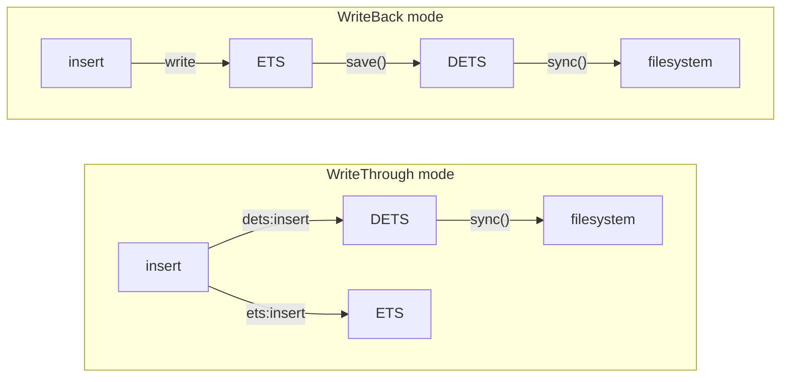

shelf provides four persistence operations to control how and when data moves between memory (ETS) and disk (DETS).

## Overview

| Function | Behavior |
|----------|----------|
| `save(table)` | Atomic snapshot ETS → DETS (writes to a temp file, then renames for crash safety) |
| `reload(table)` | Discard ETS, reload from DETS |
| `sync(table)` | Flush DETS write buffer to OS |
| `close(table)` | Save + close DETS + delete ETS |

## save

Atomically snapshots the entire ETS table into DETS, replacing all DETS contents with the current ETS state.

The save uses a temp-file-plus-rename strategy for crash safety: data is written to a temporary file first, then atomically renamed over the original DETS file. If the process is killed mid-save, the original file remains intact until the rename succeeds.

The rename is atomic only on one filesystem, so each save first creates a
private directory beside the database and writes the temporary file there.
It creates the directory exclusively and never touches an unrelated
`<database>.tmp` file. When the save succeeds or fails in a handled way, it
removes only its own temporary file and directory. The guardian tracks the
directory too: if the owner exits during save, it waits for the temporary
DETS file to close and then cleans up. Only a VM crash leaves the directory
behind; see [Manual cleanup after a VM crash](#manual-cleanup-after-a-vm-crash).
While save closes and reopens the original DETS file, the database path stays
reserved, so no other table can open it in between.

Internally, the ETS-to-DETS copy uses `ets:to_dets/2`, which transfers entries inside the Erlang VM without materializing the table as a list.

```gleam
// After a batch of writes...
let assert Ok(Nil) = set.save(table)
```

**When to use**: In WriteBack mode, call `save()` to persist changes to disk. Common strategies:
- On a periodic timer (e.g., every 30 seconds)
- After a batch of N writes
- At application shutdown
- After critical data changes

In WriteThrough mode, each write reaches DETS before ETS, so you do not need
a full snapshot after every change. DETS can buffer writes; use `sync()` to
flush that buffer to the file.

For exactly which on-disk layer this call advances data past, and what
guarantees it gives across crashes, see [Durability story](#durability-story).

### File access controls

On POSIX filesystems, `save()` preserves the original file's permission and
special mode bits, owner (uid), and group (gid). Shelf applies ownership to
the snapshot before the final mode, since an ownership change can clear
special mode bits. It reads back these values before replacing the original
file. If a metadata read, update, or check fails, Shelf returns an error
without replacing the original. You can correct the cause and retry with
the same table handle. `close()` uses the same save procedure.

The Erlang file metadata API does not expose ACLs, extended attributes
(including security labels), or file flags. Shelf does not copy these
controls to the replacement file. Do not rely on them to restrict access
across `save()` or `close()`. Use a restricted parent directory and POSIX
mode bits for access control.

## reload

Validates DETS entries in a scratch ETS table before discarding unsaved
changes. Validation failure leaves the live table unchanged. On success,
reload clears the live table and copies the validated entries into it.
Concurrent readers can see empty or partially reloaded contents during
this transfer; reload is not a transaction.

```gleam
// Undo unsaved changes
let assert Ok(Nil) = set.reload(table)
```

**When to use**: In WriteBack mode, use `reload()` to discard in-memory changes and revert to the last saved state. In WriteThrough mode, ETS and DETS are always in sync, so `reload()` is rarely needed.

## sync

Forces DETS's internal write buffer out to the open DETS file by calling
`dets:sync/1`. Useful in WriteThrough mode after a critical write, when you
need pending DETS buffers reflected in the on-disk file before continuing.

```gleam
let assert Ok(Nil) = set.sync(table)
```

In WriteBack mode `sync()` is rarely needed — `save()` already writes a
fresh DETS file and reopens it.

## close

Performs a final `save()`, closes the DETS file, and deletes the ETS table. The table handle must not be used after closing.

```gleam
let assert Ok(Nil) = set.close(table)
```

For guaranteed cleanup, use `with_table` instead of manual open/close:

```gleam
let assert Ok(Nil) = {
  use table <- set.with_table("cache", "data/cache.dets", base_directory: "/app/data", key: decode.string, value: decode.string)
  set.insert(into: table, key: "key", value: "value")
}
// table is automatically closed here
```

## Persistence Flow



## Durability story

Data goes through several layers between an `insert()` call and physical
storage. Each call moves data past one or more of these layers:

| Layer | Where data lives | Call that advances data past this layer |
|-------|------------------|------------------------------------------|
| 1 | Application memory | `insert()`, `delete_*`, `update_counter` |
| 2 | ETS table (in-process) | WriteBack: `save()`. WriteThrough: every write |
| 3 | DETS in-memory buffer | `sync()` (open DETS) or `save()` (closes a temp DETS, which flushes) |
| 4 | DETS file content (OS page cache) | `save()` writes a temp file then atomically `rename()`s over the original |
| 5 | Physical disk | Not exposed — DETS does not surface `fsync(2)` on the file or its directory |

What the calls actually do:

- **`save()`** snapshots ETS → a *temporary* DETS file (`ets:to_dets/2`), closes
  that temp file (flushing its buffer), then atomically `file:rename/2`s it
  over the original DETS path and reopens at the original path. The rename
  is POSIX-atomic, so a process or VM crash mid-`save()` leaves either the
  previous file or the new file fully present — never a half-written file.
- **`sync()`** calls `dets:sync/1` on the *currently open* DETS, draining its
  in-memory write buffer into the file. It does **not** invoke `fsync(2)` on
  the file descriptor and does **not** fsync the containing directory.
- **`reload()`** replaces the ETS contents with the validated contents of the
  DETS file. It does not change durability — it changes which copy of the
  data the table reflects.
- **`close()`** performs a `save()` and then closes DETS / deletes ETS.

Practical guarantees:

| You want… | Then call |
|-----------|-----------|
| WriteBack changes safe across a process crash | `save()` |
| WriteThrough writes flushed past DETS's buffer into the file | `sync()` |
| Strongest crash safety shelf can provide | `save()` — the atomic rename needs no further shelf call |
| `fsync(2)`-level guarantees against OS crash / power loss | Not provided. If you need this, call out to a process that opens the DETS file path with `file:open/2` and `file:sync/1`, or place the data directory on a filesystem mounted with stronger durability semantics. |

## Memory cost on open and reload

On open, shelf streams DETS entries through `dets:foldl/3`, validates them
with your decoders, and inserts them into ETS in batches of 5,000 entries.
It does not create a list of the full table.

Reload first loads a scratch ETS table while the live table remains in
memory. After validation, it clears the live table and transfers entries
from scratch. Set transfers use selection batches of 5,000 entries. Bags
and duplicate bags copy one complete key group at a time to preserve value
order and duplicates. A single large key group can still require a
full-table-sized list.

Plan for both ETS tables, transfer batches, and DETS and decoder memory
during reload. The batch size limits entry counts, not bytes; memory use
depends on the size of your values and the runtime. Reducing transfer
memory does not remove the scratch table.

Open and reload costs grow with the number and size of entries. Reads
after loading use ETS without further DETS I/O.

## Manual cleanup after a VM crash

A VM crash during `save()` or the save in `close()` can leave a
`.shelf-save-<pid>-<counter>` directory beside the database. It can contain
`snapshot.dets`, DETS sidecars such as `snapshot.dets.1`, and file_sorter
temporary files such as `fs_nonode@nohost_86491_386.17`. Leftovers can approach
the table's size, and repeated crashes can consume more disk space.

Later `open()`, `save()`, and `close()` calls do not remove these abandoned
directories. Automatic recovery remains deferred in
[#107](https://github.com/tylerbutler/shelf/issues/107); use manual cleanup.

Existing directories, including legacy leftovers, have no database or host
ownership marker. The directory name, PID, age, or expected filenames do not
prove ownership or abandonment. Another VM can still be writing a snapshot,
including for another database in the same parent directory.

1. Stop all applications and BEAM VMs that can write to the parent directory,
   including users of other databases and other hosts that share the storage.
   Prevent restarts until cleanup ends. Closing one table in one VM is not
   sufficient.
2. Confirm the intended database path and back up the database file. Do not
   replace it with a leftover `snapshot.dets`; an interrupted save can leave
   an incomplete snapshot.
3. Inspect one exact candidate directory without following symbolic links.
   Use independent records of the interrupted save to establish ownership
   of the directory and its contents. Shelf does not store that attribution.
   If you cannot establish ownership, leave the directory untouched.
4. Check all entries before deleting anything. If you find an unknown file,
   a symbolic link, or a nested directory, leave the candidate untouched.
   Otherwise, remove only the regular snapshot and sidecar files you have
   confirmed belong to that abandoned save, then remove the empty directory.
   Do not recurse, follow links, or delete sibling paths with a wildcard.
5. If an inspection, backup, or removal fails, stop and retain the remaining
   files. Record the exact path and error before investigating. Resume the
   applications only after cleanup ends, then verify the expected persisted
   data.

Leave unrelated files, directories, and symbolic-link targets unchanged. If
ownership remains uncertain, retain the candidate and investigate rather than
delete it to reclaim space.
