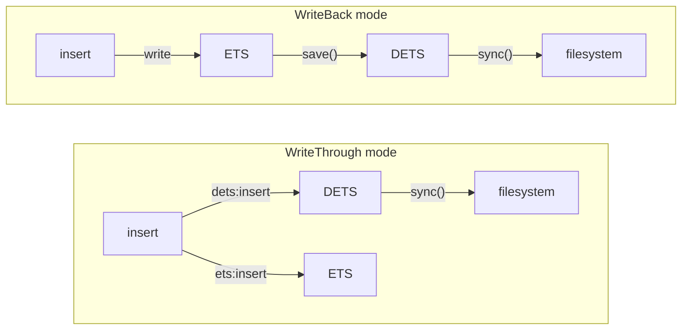

shelf provides four persistence operations to control how and when data moves between memory (ETS) and disk (DETS).

## Overview

| Function | Behavior |
|----------|----------|
| `save(table)` | Atomic snapshot ETS → DETS (writes to a temp file, then renames for crash safety) |
| `reload(table)` | Discard ETS, reload from DETS |
| `sync(table)` | Flush DETS writes and synchronize dirty file data |
| `close(table)` | Save + close DETS + delete ETS |

## save

Atomically snapshots the entire ETS table into DETS, replacing all DETS contents with the current ETS state.

The save uses a temp-file-plus-rename strategy for crash safety: data is written to a temporary file first, then atomically renamed over the original DETS file. If the process is killed mid-save, the original file remains intact until the rename succeeds.

Internally, the ETS-to-DETS copy uses `ets:to_dets/2`, which transfers entries inside the Erlang VM without materializing the table as a list.

```gleam
// After a batch of writes...
let assert Ok(Nil) = set.save(table)
```

**When to use**: In WriteBack mode, call `save()` to persist changes to disk. Common strategies:
- On a periodic timer (e.g., every 30 seconds)
- After a batch of N writes
- At application shutdown
- After critical data changes

In WriteThrough mode, each write goes to DETS before it returns. You rarely
need to call `save()` manually, but DETS can buffer writes in memory.
Call `sync()` after critical writes.

For exactly which on-disk layer this call advances data past, and what
guarantees it gives across crashes, see [Durability story](#durability-story).

## reload

Validates DETS entries in a scratch ETS table before discarding unsaved
changes. Validation failure leaves the live table unchanged. On success,
reload clears the live table and copies the validated entries into it.
Concurrent readers can see empty or partially reloaded contents during
this transfer; reload is not a transaction.

```gleam
// Undo unsaved changes
let assert Ok(Nil) = set.reload(table)
```

**When to use**: In WriteBack mode, use `reload()` to discard in-memory changes and revert to the last saved state. In WriteThrough mode, ETS and DETS are always in sync, so `reload()` is rarely needed.

## sync

Calls `dets:sync/1` to flush pending DETS writes. When saving a dirty
disk-backed table, DETS also calls `file:sync/1` to synchronize file data.
Use `sync()` after a critical WriteThrough write.

```gleam
let assert Ok(Nil) = set.sync(table)
```

`sync()` does not copy unsaved ETS changes into DETS. In WriteBack mode,
call `save()` to write those changes.

DETS can skip file synchronization if it has already marked the table as
saved. Calling `sync()` after `save()` is therefore not a general way to
make the snapshot rename durable. Neither call synchronizes the containing
directory after file creation or rename.

## Durability story

Data goes through several layers between an `insert()` call and physical
storage. Use this section to choose a persistence operation.

| Layer | Data location | Operation |
|-------|------------------|------------------------------------------|
| 1 | Application memory | `insert()`, `delete_*`, `update_counter` |
| 2 | ETS table | WriteBack: `save()`. WriteThrough: each write also goes to DETS |
| 3 | DETS in-memory buffer | `sync()` (open DETS) or `save()` (closes a temp DETS, which flushes) |
| 4 | File data in the OS cache | `sync()` calls `file:sync/1` when saving a dirty disk-backed DETS table |
| 5 | Directory entries after file creation or rename | Shelf does not synchronize directories |

File synchronization depends on the guarantees of the filesystem, operating
system, and storage device. It does not synchronize a separate directory
entry that creates or replaces the database path.

What the calls actually do:

- **`save()`** snapshots ETS → a *temporary* DETS file (`ets:to_dets/2`), closes
  that temp file (flushing its buffer), then atomically `file:rename/2`s it
  over the original DETS path and reopens at the original path. The rename
  is POSIX-atomic, so a process or VM crash mid-`save()` leaves either the
  previous file or the new file fully present — never a half-written file.
- **`sync()`** calls `dets:sync/1` on the currently open DETS. On the tested
  OTP 27.2.1 runtime, saving a dirty disk-backed table calls `file:sync/1`.
  An already-saved table can return without that call. See OTP's
  [`perform_save/2`](https://github.com/erlang/otp/blob/OTP-27.2.1/lib/stdlib/src/dets.erl#L2491-L2520)
  and [`dets_utils:sync/1`](https://github.com/erlang/otp/blob/OTP-27.2.1/lib/stdlib/src/dets_utils.erl#L267-L275).
  Shelf does not synchronize the containing directory.
- **`reload()`** discards the ETS table and rebuilds it from the on-disk DETS
  file. It does not change durability — it changes which copy of the data
  the table reflects.
- **`close()`** performs a `save()` and then closes DETS / deletes ETS.

Practical guarantees:

| You want… | Then call |
|-----------|-----------|
| WriteBack changes safe across a process crash | `save()` |
| WriteThrough writes flushed, with file synchronization when DETS is dirty | `sync()` |
| A complete replacement snapshot across a process or VM crash | `save()` |
| Full durability across OS crash or power loss | Shelf does not guarantee this. File data and directory entries after creation or rename both need synchronization, with suitable filesystem and device guarantees. |

## Memory cost on open and reload

On open, shelf streams DETS entries through `dets:foldl/3`, validates them
with your decoders, and inserts them into ETS in batches of 5,000 entries.
It does not create a list of the full table.

Reload first loads a scratch ETS table while the live table remains in
memory. After validation, it clears the live table and transfers entries
from scratch. Set transfers use selection batches of 5,000 entries. Bags
and duplicate bags copy one complete key group at a time to preserve value
order and duplicates. A single large key group can still require a
full-table-sized list.

Plan for both ETS tables, transfer batches, and DETS and decoder memory
during reload. The batch size limits entry counts, not bytes; memory use
depends on the size of your values and the runtime. Reducing transfer
memory does not remove the scratch table.

Open and reload costs grow with the number and size of entries. Reads
after loading use ETS without further DETS I/O.

This is the canonical reference for shelf's load-time memory and time
cost; other pages link here.

## close

Performs a final `save()`, closes the DETS file, and deletes the ETS table. The table handle must not be used after closing.

```gleam
let assert Ok(Nil) = set.close(table)
```

For guaranteed cleanup, use `with_table` instead of manual open/close:

```gleam
let assert Ok(Nil) = {
  use table <- set.with_table("cache", "data/cache.dets", base_directory: "/app/data", key: decode.string, value: decode.string)
  set.insert(into: table, key: "key", value: "value")
}
// table is automatically closed here
```

## Persistence Flow


